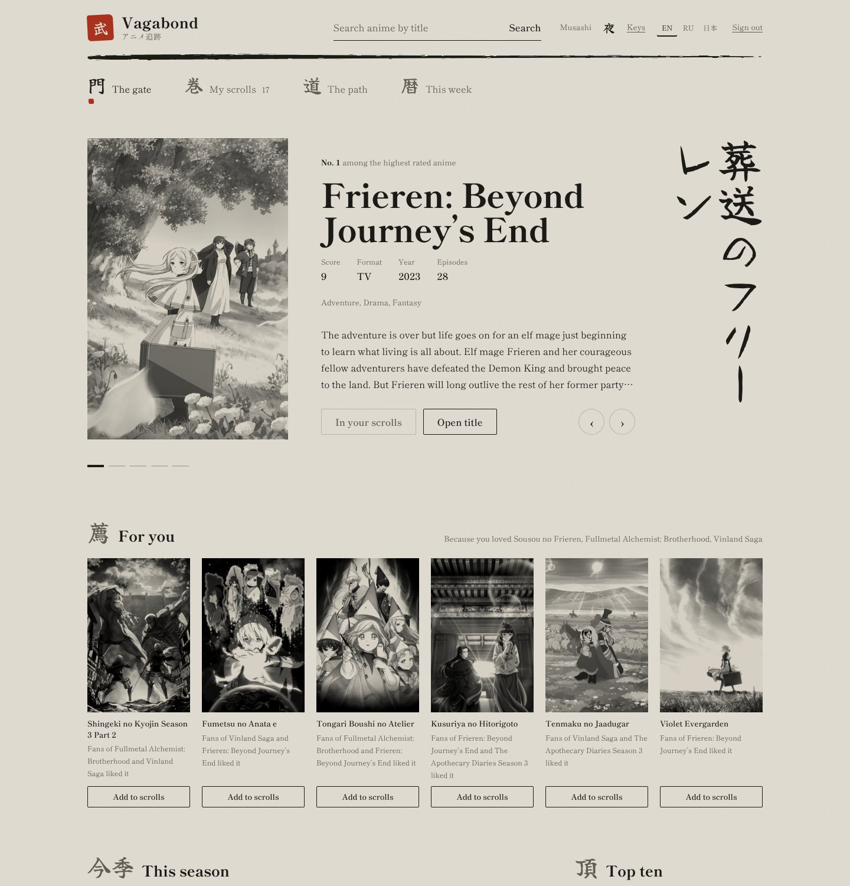
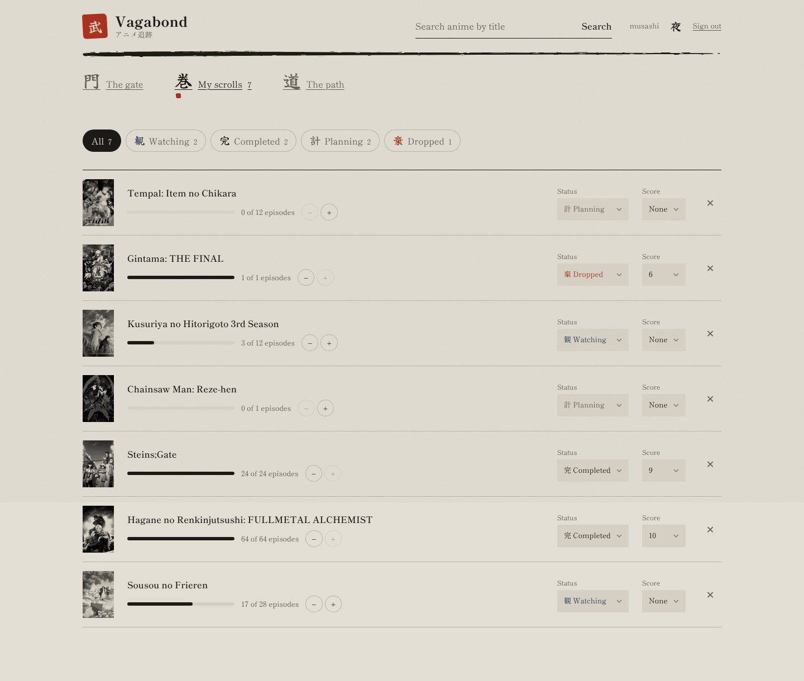
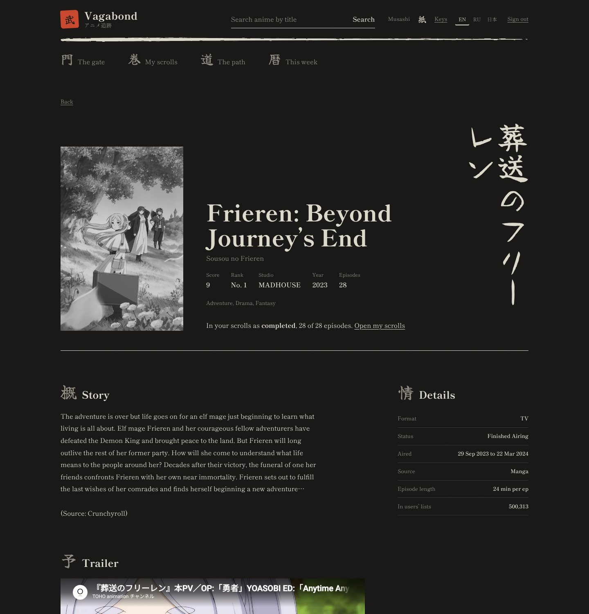
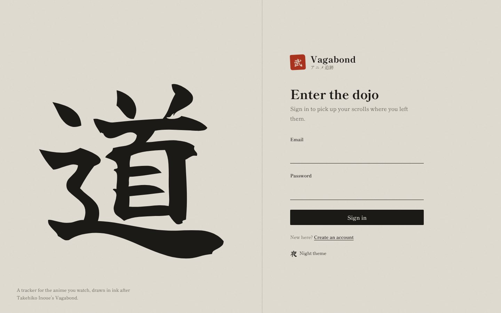

## 🖼️ Preview

<table width="100%">
  <tr>
    <td width="50%" align="center"><b>The Gate</b></td>
    <td width="50%" align="center"><b>My Scrolls</b></td>
  </tr>
  <tr>
    <td></td>
    <td></td>
  </tr>
  <tr>
    <td align="center"><b>The Path</b></td>
    <td align="center"><b>Title page, night theme</b></td>
  </tr>
  <tr>
    <td></td>
    <td></td>
  </tr>
  <tr>
    <td align="center"><b>Sign in</b></td>
    <td align="center"><b>Mobile</b></td>
  </tr>
  <tr>
    <td></td>
    <td align="center"></td>
  </tr>
</table>

# ⚔️ VAGABOND TRACKER (アニメ追跡)

> A cinematic, avant-garde Anime Tracker inspired by the meditative and brutal ink-wash (*sumi-e*) aesthetic of Takehiko Inoue's legendary manga **"Vagabond"**. This is not just a standard catalog; it is an interactive web experience wrapped around the philosophy of a warrior's path.
>
> *Created with dedication to the warrior's path and flawless code architecture. 🏯*

---

## 👁️ Visual Philosophy & UX Innovations

* **Ink on paper:** Vagabond is drawn in sumi ink on paper, so the whole app is a sheet of washi. Every poster is *printed in ink* (grayscale, blended into the paper with `mix-blend-mode: multiply`) and the colour bleeds back in when you hover or focus it.
* **Two themes:** paper (紙) by default and night (夜) for the dark. The choice follows the system setting and is remembered.
* **Brush only where it matters:** large kanji are set in the brush face *Yuji Boku*; everything else in the mincho *Shippori Mincho B1*. Red appears only as seals: the logo, the active section and the 録 stamp that lands on a poster when you add it.
* **THE GATE (門):** the top five titles with their Japanese names written vertically like a scroll inscription, this season's anime and the top ten ranked in kanji numerals.
* **MY SCROLLS (巻):** status filters with counts, a progress stroke that grows with each episode, −/+ buttons, status and score inline. Finishing the last episode marks the title completed.
* **THE PATH (道):** raw SQL aggregates rendered as four large kanji (**観, 完, 計, 棄**), a proportion bar and your hours on the road.
* **Resilient API handling:** Jikan 429/5xx responses are retried automatically, and every failure explains what happened with a retry action.
* **Accessible by default:** keyboard focus, labelled controls, `prefers-reduced-motion` respected, responsive down to phones. The current tab and search live in the URL, so Back works as expected.

---

## 🛠️ Tech Stack & Architecture

### Frontend (Client)


* **Axios Instance Layer:** Powered by structural request interceptors for automatic JWT session attachment.
* **Token-based CSS:** one stylesheet with paper/night design tokens instead of inline styles.

### Backend & Cloud (Server)


* **Raw SQL Optimization:** Relational database infrastructure utilizing optimized `COALESCE` statements for partial resource patches (`PATCH`), custom cascade deletions, and unique structural key constraints.
* **Security & Auth:** Password hashing utilizing salted `bcryptjs` and session authorization via secured `jsonwebtoken` tokens with an automatic `/auth/me` validation endpoint.

---

## 📁 Repository Structure

```text
vagabond-anime-tracker/
├── client/              # React + Vite frontend application
│   └── src/
│       ├── api/         # Centralized Axios configs and Jikan API integration
│       ├── components/  # Masthead, InkImage, Stamp, Enso loader, PosterCard…
│       ├── pages/       # AuthPage, AnimeDetailPage, TrackerPage + tracker/ views
│       ├── lib/         # status constants, theme hook
│       └── index.css    # design tokens and all styles (paper / night themes)
└── server/              # Node.js + Express + PostgreSQL core
    ├── .env.example     # Environment template
    └── server.js        # DB init, REST endpoints, JWT middleware, input validation, anime API proxy
```

---

## 🚀 Local Deployment (Entering The Dojo)

### 1. Clone the repository
```bash
git clone https://github.com/zxcmazokdyrak12/vagabond-anime-tracker.git
cd vagabond-anime-tracker
```

### 2. Setup the Database & Server
Navigate to the `/server` directory and install back-end packages:
```bash
cd server
npm install
```
Create a `.env` file based on `.env.example` and supply your `DATABASE_URL` (PostgreSQL connection string), `JWT_SECRET` and optionally `CLIENT_URL` (allowed CORS origin). The server refuses to start without `DATABASE_URL` and `JWT_SECRET`. 

Boot the backend:
```bash
npm start
```
*The database tables will initialize automatically on boot. Terminal will log `DB ready` and `Server: http://localhost:3002`.*

### 3. Launch the Frontend
Navigate to the `/client` directory and install dependencies:
```bash
cd ../client
npm install
```
To point the client at your local backend, create `client/.env` with `VITE_API_URL=http://localhost:3002` (see `client/.env.example`). Then launch the Vite development server:
```bash
npm run dev
```
Open `http://localhost:5173` in your browser, click **Create an account**, and enter the dojo.

---

## ⚖️ License & Disclaimer

Vagabond Tracker is a non-commercial fan project created purely for educational and portfolio demonstration purposes. All structural visual assets, original concepts, and character artwork references belong to Takehiko Inoue and Kodansha.
